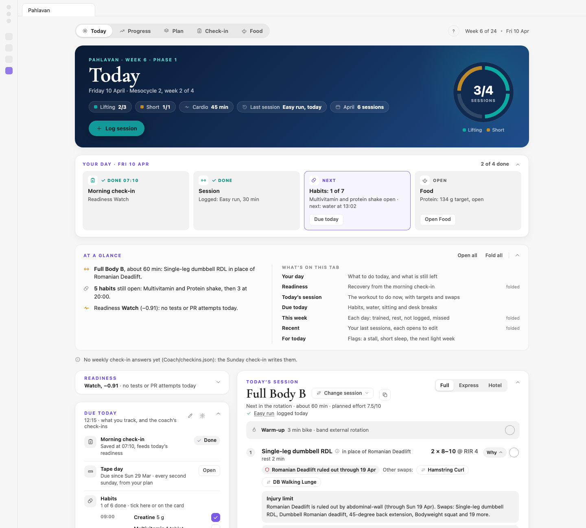
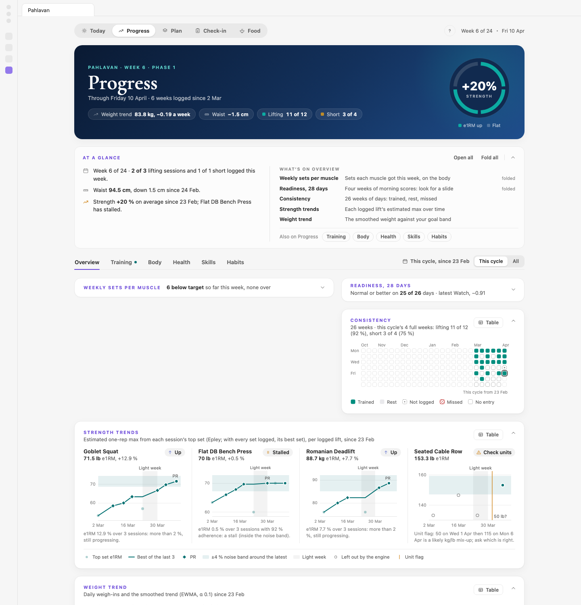
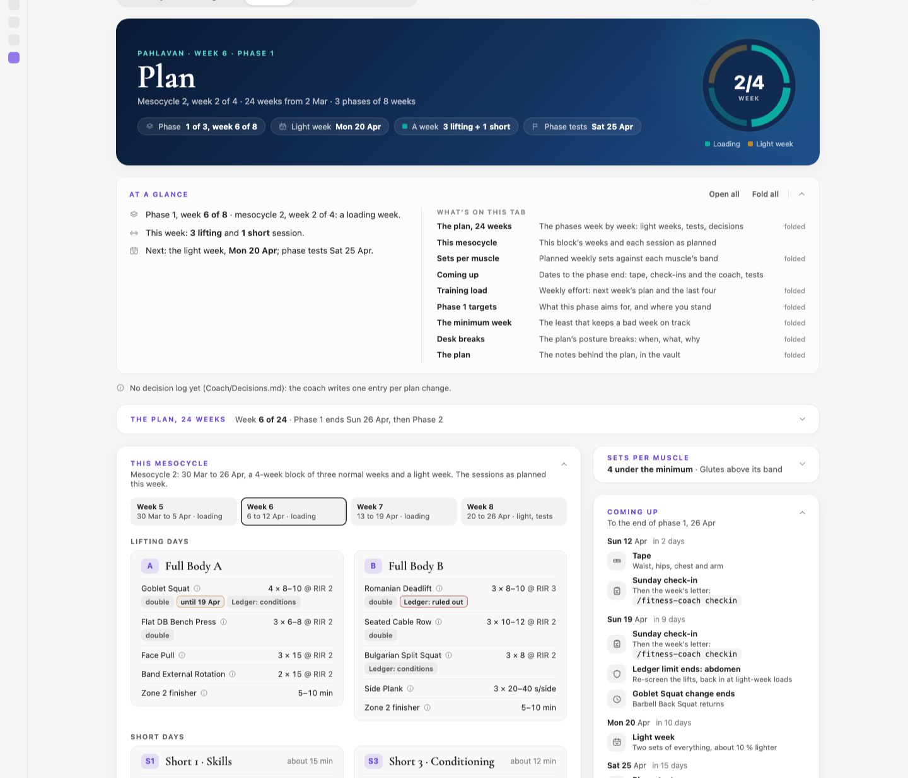
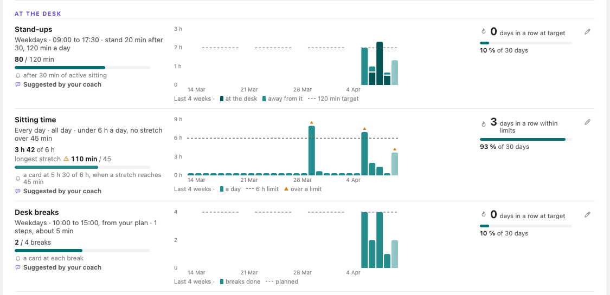
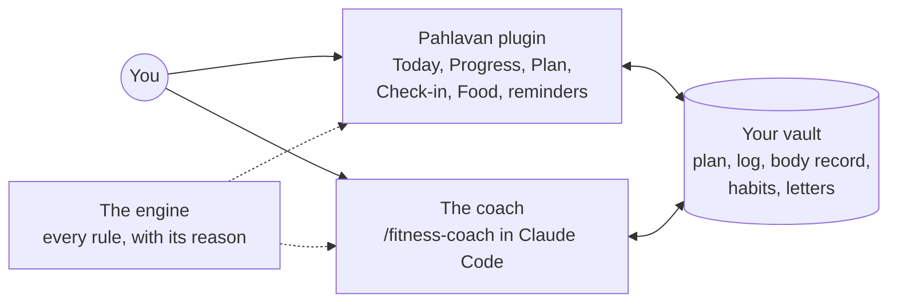
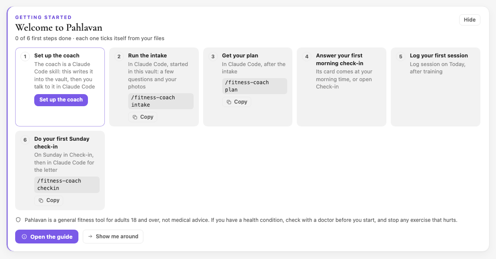

# Pahlavan

**A training coach that lives in your Obsidian vault.** It plans your training from your own goals, time and equipment, shows you today's session, keeps the log and helps you look back each week. Everything sits in plain files in your vault, so your data stays yours.

<picture>
  <source media="(prefers-color-scheme: dark)" srcset="docs/images/today-dark.png">
  
</picture>

> [!NOTE]
> **Pahlavan is a free beta.** I use it every day, and it may still change. Bug reports and ideas are welcome in [GitHub issues](../../issues).

The name is Persian for a champion, the wrestlers and heroes of the old stories.

## What it does

Pahlavan has two parts that work on the same files: a **plugin**, the screens you see in Obsidian, and a **coach** you talk to in [Claude Code](https://claude.com/claude-code).

### Today: what to do now

The session to do, with how to do each movement and why it's in your plan, the sets and reps to aim for, swaps when a lift doesn't suit you today, and a checklist that ticks itself when you log. Around it: how ready you feel from the morning check-in, what's due today, and your week so far.

### Progress: how it's going

Your week, sets per muscle on a body map, your strength trend for each logged lift, your weight trend, your body record and progress photos, and your consistency over the months.

### Plan: the whole plan, with its reasons

The phases and their 4-week blocks, this block's sessions, what's coming up (light weeks, tests, check-ins), and the reason behind every exercise.

### Habits: the small daily things

Supplements, water, protein and your own ticks, each with its reminder and its history. For desk work there are stand-ups, sitting time and desk breaks, with a chart of each day against your target.

### The coach: the thinking the screens can't do

The `/fitness-coach` skill in Claude Code:

- **Intake:** a safety screen, a short interview and an optional body assessment from photos.
- **Plan:** a plan designed for you, compared against other options, with the evidence for each choice.
- **Sunday check-in:** reads your week and writes you a short letter with one thing to focus on.
- **Reviews, progress reports, an eating plan and habit suggestions**, when you want them.
- **Logging and questions:** tell it what you did, or ask how things are going.

## How it works

The plugin and the coach read and write the same files in your vault, and both get their numbers from one engine, so a number on a screen and a number in a letter always agree. Every number comes with its reason: why this weight, why a light week now, why this exercise is in your plan.

## What you need

- **Obsidian on a computer,** version 1.5.0 or later. Pahlavan is desktop only, built and tested on macOS. Sitting time from your keyboard and mouse, and turning dropped photos into JPEG, work only on a Mac.
- **For the coach:** Claude Code, which needs a Claude plan that includes it, and [Node.js](https://nodejs.org) 18 or later.

## Install

1. In Obsidian, open **Settings → Community plugins**, turn them on if you haven't, choose **Browse**, search for **Pahlavan**, then **Install** and **Enable**.
2. Or by hand: download `main.js`, `manifest.json` and `styles.css` from the [latest release](../../releases/latest) into a folder named `pahlavan` inside your vault's `.obsidian/plugins/`, then enable it under **Community plugins**.

## Your first run

1. Open Pahlavan from the ribbon or the command palette (**Open Pahlavan**). Today shows a welcome card with your first steps.
2. **Set up the coach:** the first step's button copies the coach into your vault (`.claude/skills/fitness-coach/`). It's also under **Settings → Pahlavan → Coach**.
3. Open Claude Code in your vault's folder and type `/fitness-coach intake`. Answer its questions; it writes your profile.
4. Type `/fitness-coach plan`. The coach designs your plan and, once you say yes, writes it. Today shows your first session.

Each step ticks itself once its file is there. The [user guide](docs/user-guide.md) walks through every screen.

## Questions

**Do I need Claude Code?** The screens open without it, but your plan comes from the coach's intake and plan steps, so you need it to use Pahlavan fully.

**What does it cost?** Pahlavan is free during the beta. Claude Code comes with Anthropic's Claude plans, which are separate from Pahlavan.

**Where does my data go?** Into plain JSON and Markdown files in your vault, nowhere else. The plugin makes no network requests. When you talk to the coach, Claude Code sends your messages and the files it reads to Anthropic under your own account, as it does for anything you do in Claude Code.

**Does it work on my phone?** No, Pahlavan is desktop only. On Windows and Linux the screens should work, but they aren't tested there yet.

**Is it medical advice?** No. See Safety below.

## Safety

Pahlavan is a general fitness tool for adults 18 and over, not medical advice. If you have a health condition, check with a doctor before you start, and stop any exercise that hurts.

The coach screens for risks before it plans anything. It doesn't coach anyone under 18, refers pregnancy and the warning signs it asks about to a clinician, and never diagnoses.

## Privacy and what Pahlavan touches

- **No network.** The plugin makes no network requests of its own. No analytics, no telemetry, no ads.
- **The coach runs in Claude Code.** When you talk to the coach, Claude Code sends your messages and the files it reads to Anthropic under your own Claude account, as it does for anything you do in Claude Code. Pahlavan adds no other service.
- **An account for full use.** The coach needs Claude Code, and Claude Code needs a Claude plan that includes it. Pahlavan itself is free.
- **Programs it runs, outside your vault.**
  - **Set up the coach** looks for Node.js by running `node --version`: from Obsidian's search path, then Homebrew's and Volta's usual folders, then your login shell.
  - On a Mac it runs `ioreg` to read how long the keyboard and mouse have been idle, for sitting time. It never sees what you type.
  - It runs `sips` to turn photos you drop in (HEIC and others) into JPEG, at most 1600 pixels on the long side. It copies the photo into a temporary folder, converts it there, and removes the folder.
- **Files it writes, all inside your vault.**
  - Your plan, log, body record and habit check-ins: `plan-data.json`, `fitness-log-data.json`, `body-data.json` and `habits-data.json`, in your fitness folder (`Fitness/` unless you choose another in the settings).
  - The coach's files in `Fitness/Coach/`: your profile, check-ins, letters, decisions, eating plan and tracked items. Sitting time is kept per computer in `Fitness/Coach/sitting.json`, under each computer's name.
  - Progress photos in `Fitness/Progress Photos/`.
  - The coach skill in `.claude/skills/fitness-coach/`, when you set it up.
  - Its own settings, in `.obsidian/plugins/pahlavan/`.

## Support

Pahlavan is free. If it helps you, you can [buy me a coffee on Ko-fi](https://ko-fi.com/saeedghorbani70608). Bugs and ideas go in [GitHub issues](../../issues).

## License

Copyright 2026 Saeed Ghorbani. Pahlavan is source-available under the [Elastic License 2.0](LICENSE): you may use it, read its code and change it. You may not offer it to others as a hosted or managed service, get around or remove a licence key, or remove its licence and copyright notices. It's free during the beta.

The Progress body map draws the outlines and muscle shapes of [react-native-body-highlighter](https://github.com/HichamELBSI/react-native-body-highlighter), in `plugin/src/ui/body-map.ts`, under its MIT License:

> MIT License. Copyright (c) 2022 ELABBASSI Hicham. Permission is hereby granted, free of charge, to any person obtaining a copy of this software and associated documentation files (the "Software"), to deal in the Software without restriction, including without limitation the rights to use, copy, modify, merge, publish, distribute, sublicense, and/or sell copies of the Software, and to permit persons to whom the Software is furnished to do so, subject to the following conditions: The above copyright notice and this permission notice shall be included in all copies or substantial portions of the Software. THE SOFTWARE IS PROVIDED "AS IS", WITHOUT WARRANTY OF ANY KIND, EXPRESS OR IMPLIED, INCLUDING BUT NOT LIMITED TO THE WARRANTIES OF MERCHANTABILITY, FITNESS FOR A PARTICULAR PURPOSE AND NONINFRINGEMENT. IN NO EVENT SHALL THE AUTHORS OR COPYRIGHT HOLDERS BE LIABLE FOR ANY CLAIM, DAMAGES OR OTHER LIABILITY, WHETHER IN AN ACTION OF CONTRACT, TORT OR OTHERWISE, ARISING FROM, OUT OF OR IN CONNECTION WITH THE SOFTWARE OR THE USE OR OTHER DEALINGS IN THE SOFTWARE.

## For developers

How the engine, the plugin and the coach fit together, and how to build and test them: [docs/development.md](docs/development.md). Release notes: [CHANGELOG.md](CHANGELOG.md).
