# Pahlavan user guide

Pahlavan is a training coach that lives in your Obsidian vault. It has two parts that work on the same files. The **plugin** is a tab in Obsidian with five screens (Today, Progress, Plan, Check-in and Food) and reminder cards that pop up through the day. The **coach** is an AI skill you run in Claude Code with `/fitness-coach`: it interviews you, designs your plan, reviews your week and writes you a letter every Sunday. You use the plugin by hand every day; the coach does the thinking and makes the plan changes. Everything stays in your vault as plain files, with no account and no server.

This guide covers plugin 0.25.2 and engine 0.25.2. The screenshots come from a practice vault with made-up data, so your numbers will differ.

> [!WARNING] Safety
> Pahlavan is a general fitness tool for adults 18 and over, not medical advice. If you have a health condition, check with a doctor before you start, and stop any exercise that hurts.

> [!TIP]
> New here? Read [Get started](#get-started) and [Your day](#your-day) first. Come back to [The screens](#the-screens) and [Key ideas](#key-ideas-in-plain-words) when a card or a number puzzles you.

## Contents

- [What you need](#what-you-need)
- [Get started](#get-started)
- [Your day](#your-day)
- [Your Sunday check-in and letter](#your-sunday-check-in-and-letter)
- [The light week, every four weeks](#the-light-week-every-four-weeks)
- [The screens](#the-screens)
- [Help inside Pahlavan](#help-inside-pahlavan)
- [Reminder cards](#reminder-cards)
- [Logging from the phone](#logging-from-the-phone)
- [The coach and its jobs](#the-coach-and-its-jobs)
- [Key ideas in plain words](#key-ideas-in-plain-words)
- [Troubleshooting and questions](#troubleshooting-and-questions)

## What you need

- **Obsidian 1.5 or later on a desktop computer.** Pahlavan doesn't run on phones yet, but an iPhone can send it what you log (see [Logging from the phone](#logging-from-the-phone)).
- **A Mac, for every reminder to work.** macOS notifications, stand-ups and sitting time (they read keyboard and mouse activity) and photo conversion (iPhone HEIC to JPEG) use the Mac. On another computer the cards still appear inside Obsidian, but stand-ups and sitting time don't count.
- **Claude Code, opened in your vault's folder, for the coach.** The coach writes your plan, so without it Pahlavan has no session to show.
- **Node.js and Python 3** on the computer where you run the coach. Its scripts use both.
- **The folder Pahlavan reads.** Your fitness files go in a `Fitness/` folder, with the habit check-ins beside them. To keep them somewhere else, set **Files** in Pahlavan's settings (a vault that already holds a plan elsewhere is found on its own). The coach's helper scripts still go in `5-System/Scripts/` for now.

## Get started

### Install the plugin

Pahlavan isn't in Obsidian's community plugin list yet, so you install it by hand.

1. In your vault, create the folder `.obsidian/plugins/pahlavan/`.
2. Copy the plugin's three files into it: `main.js`, `manifest.json` and `styles.css`. From the project folder, `npm run ship-plugin -- <your vault>/.obsidian/plugins/pahlavan` builds the files and copies them there.
3. In Obsidian, open **Settings**, then **Community plugins**, and turn on **Pahlavan**. If Obsidian asks, turn on community plugins first.
4. Click Pahlavan's icon in the left ribbon (two crossed clubs), or run **Pahlavan: Open** from the command palette. Pahlavan opens in a tab and remembers the screen you used last.

To install the coach, copy the `fitness-coach` skill folder into `.claude/skills/` in your vault. Run `npm run ship-skill -- <the skill folder>` from the project to put the current engine in the skill's `scripts/` folder.

Until you've done the intake, the screens are mostly empty, and each says what fills it: Plan and Food each have a card with the coach's command to copy. Today shows a **Welcome to Pahlavan** card with your first six steps, starting with **Set up the coach**, and the **?** at the top right opens this guide (see [Help inside Pahlavan](#help-inside-pahlavan)).

### Run your first intake

The intake is your first conversation with the coach, like meeting a coach in person. In Claude Code, from your vault folder, type:

```
/fitness-coach intake
```

The coach asks in short rounds of up to four questions. Answer in plain words. "I don't know" is fine: that field stays "unknown".

1. **Safety screening.** Four questions: whether you've exercised regularly over the last 3 months; whether a doctor has told you about a heart, metabolic or kidney condition; any warning signs, such as chest pain, fainting or unusual breathlessness; and whether you're under 18, pregnant, or have had a new diagnosis, medicine, surgery or injury. If an answer needs a doctor's view, the coach stops there and says so. Until you're cleared, it keeps your logging going but plans nothing.
2. **Basics and goals.** Your sex (used only for estimates), age, height, morning weight and waist at the navel (if you can measure it), and up to three goals: build strength, build muscle, lose fat, recomposition (leaner at the same weight), health and longevity, conditioning, calisthenics skills, posture and mobility, or your own. For each goal, how important it is and how confident you are that you'll do what it takes, each from 0 to 10.
3. **Success and your week.** What success would look like, in something you can measure, and whether it has a date. How many days a week you can train and for how long, including any shorter days.
4. **Limits, equipment and logging.** Days that never work and busy periods you already know about; where you train, with what, and your heaviest dumbbell; how long you've trained; and how much logging you'll put up with:
   - **Light:** the session done, its minutes and how hard it felt;
   - **Standard:** the top set (your heaviest set) of each main lift;
   - **Full:** every set, with reps in reserve.

   The coach never pushes you to a higher level.
5. **Body history and preferences.** Injuries, niggles or surgeries that still affect your training (each gets a few follow-up questions and an entry in your **Ledger**, the record of injuries and the limits they put on exercises); exercises you enjoy and ones you'd rather never do; week layouts you've liked or disliked; the cardio you'll actually do; and what usually happens when a week goes badly.

Then comes the body assessment (next section). If your vault already holds training history, one last question asks whether to use it for starting weights or to start clean.

The intake also asks about your day: desk work, a standing desk, when you sleep and wake, and any supplements or medicines. From your answers it proposes up to three daily items to track (for example creatine, stand-ups or a sitting limit), each with its reason, and asks what time your morning check-in should come. You choose which items to keep.

At the end you see a short summary of your profile, and nothing is written until you say yes. Then the coach writes your profile, your Ledger and your first tracked items. It also writes the cycle's **baseline note**, `Baseline - <date>.md`, dated the intake's day: every screen counts the new **cycle** from it (a cycle is one fresh start: a new intake and a new plan). And it records your weight, waist and self-check results as the cycle's first entries, so Progress starts from them.

Give your weight and waist in kilograms and centimetres, or in pounds and inches: the unit you answer in becomes your body units. Pahlavan shows and takes your weight, the tape and the wall test in them (the files keep kilograms and centimetres either way). To change them later, tell the coach.

### Photos and the movement self-check

A coach looks before planning, so the intake asks for photos and a five-minute movement check.

**The photos are optional.** They show posture, the balance between your two sides and areas that lag behind, which shapes the plan's emphasis. They stay in your vault, in `Fitness/Progress Photos/<date>/`. When the coach looks at them, they go to the AI model for that conversation, like anything else it reads. If you'd rather not, say so: the plan then relies on the self-check.

Take them the same way every time, so later sets compare:

- phone at chest height, about 2.5 to 3 m away, upright, your whole body in the frame;
- a plain background, even light from the front, and a timer or a helper;
- fitted clothing; stand relaxed, feet hip-width apart, arms by your sides. Don't pose or brace.

You take seven photos: front; side (left side to the camera); back; a closer front of your torso and head; the bottom of a bodyweight squat, from the side and from the front; and standing with both arms straight overhead, from the side. Drop them in the folder under any names, and the coach renames them.

**The movement self-check** takes about five minutes, at home or at the gym. Type your results back in plain words. Stop any test that hurts: it's left out, never guessed.

| Test | How |
|---|---|
| Sit-to-stand | Five slow squats to a knee-height chair or box, arms crossed |
| Push-ups | As many clean reps as you can, chest down to a fist's height, body straight |
| Hang and pull | A dead hang, in seconds, then as many strict pull-ups as you can |
| Plank or hollow hold | Seconds, lower back pressed down |
| Hinge | Slide your hands down your thighs with a flat back |
| Overhead reach | Back and head on a wall, arms straight up: do your thumbs touch the wall without your lower back arching? |
| Wall test | Heels, hips and shoulders on a wall: the gap behind your head, in cm |
| Balance | Stand on one leg, eyes open, 30 seconds each side |

The results choose your starting points: for example the push-up or pull-up variation you start on, and whether squats start from a box.

### Get your plan

When the intake is done, the coach offers the next step. You can also type:

```
/fitness-coach plan
```

The coach drafts your plan with the **engine** (the tested rules behind every number in Pahlavan), then makes it yours:

- it compares at least two ways of laying out your week and picks one from your answers;
- it sizes the week to what you can really do;
- it builds the long view: **phases** of 8 weeks, each made of two 4-week blocks (a **mesocycle** each) of three normal weeks and one light week. The plan's length (often 24 weeks) is what the top bar's "Week 6 of 24" counts against;
- it picks exercises from your self-check and your Ledger;
- it runs a **pre-mortem**: "it's week 6 and this failed: why?" It asks for your answer too, then builds a countermeasure into the plan for each risk.

You get one proposal, led by "How your data shaped this plan", with a one-line reason for every exercise. Ask for changes; nothing is written before your yes. Each exercise's reason then shows in Pahlavan too: under **Why** on Today and the Plan screen, as **From the plan**.

### What appears in your vault

Your files live in `Fitness/` (or the folder set in **Files** in Pahlavan's settings). You'll rarely open them, but it helps to know what's where.

| File or folder | What it holds | Written by |
|---|---|---|
| `plan-data.json` | The plan: sessions, exercises, sets and reps, and the reason for each item | The coach |
| `6-Month Roadmap.md` | The phases, targets and test dates, the pre-mortem, and "How your data shaped this plan" | The coach |
| `Month <N> Plan.md`, `Exercise Guide.md`, `Workout Log (email template).md`, `gym-companion.html` | Notes made from the plan | A script the coach runs: don't edit their generated parts |
| `Baseline - <date>.md` | The note that marks when the current cycle began | The coach, at the intake |
| `fitness-log-data.json` | Your sessions and ladder levels | The Log panel, the coach |
| `body-data.json` | Morning check-ins, tape, tests and the photo index | Check-in, the reminder cards |
| `Progress Photos/<date>/` | Your photo sets | The photo card, you |
| `Progress Reports/` | Dated progress reports | The coach |
| `Coach/Athlete profile.md`, `Coach/Ledger.md` | Your profile and your Ledger, to read | The coach |
| `Coach/Decisions.md` | Every plan change: its trigger, the rule, the expected effect and when to check it | The coach |
| `Coach/Letters/` | The Sunday letters and the block reviews | The coach |
| `Coach/Eating plan.md`, `Coach/eating-plan.json` | Your eating plan, if you ask for one (the note to read, the file the Food tab draws) | The coach |
| `Coach/checkins.json` | Your Sunday check-in answers | Check-in, the coach |
| `Coach/tracking.json` | What you track and its reminders | Habits, the coach |
| `Coach/nudges.json`, `Coach/sitting.json` | Reminder answers and sitting time, shared between computers | Pahlavan only |
| `Coach/help.json` | Which tips you've seen and whether the welcome card is hidden, which panels and sections you opened or folded, and the Food tab's light checks, shared between computers | Pahlavan only |

Don't edit the JSON files by hand. Pahlavan and the coach merge their changes into them carefully, and a hand edit can break that.

### Your first weeks

Expect two things in a new cycle.

- **Week 1 is a calibration week.** Today's session says "Calibration week: find working weights that leave 3 reps in reserve; no progression decisions." Pick loads that leave you about three more clean reps. Nothing progresses or stalls that week.
- **Readiness builds your baseline.** The Readiness card shows "Building your baseline" with a count, such as "5 of 14 morning check-ins this cycle". It needs 14 mornings in this cycle before it can compare a morning with your usual. Meanwhile it says "Train as planned", and the safety rules (short sleep, a high resting heart rate, illness) still apply.

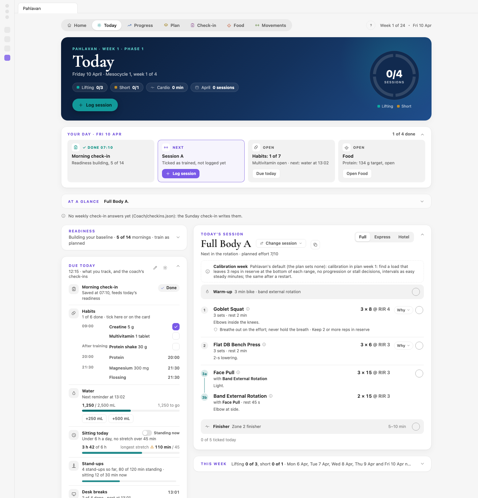

## Your day

A normal day has four touches: the morning check-in, a look at Today, training and logging it, and the reminder cards for what you track. **Your day**, at the top of Today, shows them as steps and ticks them off as you go. For the whole routine with your own times (each item at its card's time, the Sunday check-in, the light week and the phase end), open the **?** at the top and choose **Your routine** (see [Help inside Pahlavan](#help-inside-pahlavan)).

### Answer the morning check-in

Each morning, at the time you chose, the **Morning check-in** card pops up. It takes about 30 seconds.

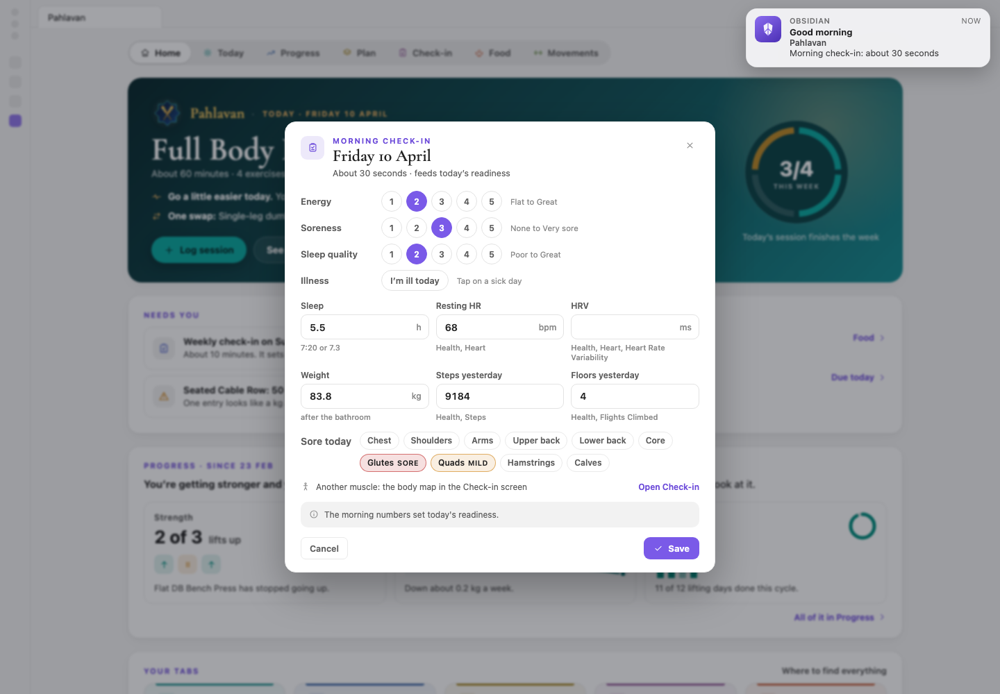

1. Tap 1 to 5 for **Energy** (Flat to Great), **Soreness** (None to Very sore) and **Sleep quality** (Poor to Great).
2. Type **Sleep** in hours ("7:20" or "7.3"), **Resting HR** from your watch or phone, **Weight** in your units, kg or lb (after the bathroom), and **Steps yesterday** and **Floors yesterday**. Pahlavan doesn't read your phone's Health app: copy the numbers across, or leave them blank.
3. Under **Sore today**, tap an area that's sore: once for mild, twice for sore, a third time to clear it. The areas are chest, shoulders, arms, upper back, lower back, core, glutes, quads, hamstrings and calves.
4. Press **Save**.

A muscle you mark sore trims its sets in today's session. For a muscle the quick pick doesn't name, click **Open Check-in** on the card: the Check-in screen has the full body map.

Missed the card? Open the **Check-in** tab, or run **Pahlavan: Open the morning check-in**. The card keeps coming until 21:00.

The check-in counts as done once you answer energy, soreness or sleep quality. Numbers on their own (sleep hours, resting HR, weight or steps from your phone) fill their fields, but the card still asks the three questions, and every screen agrees.

Energy, soreness, sleep quality, sleep and resting heart rate are the five inputs to Readiness on Today. Weight goes into your weight trend, and steps into Health.

### Read Today

Today answers one question: what should I do today, and why?

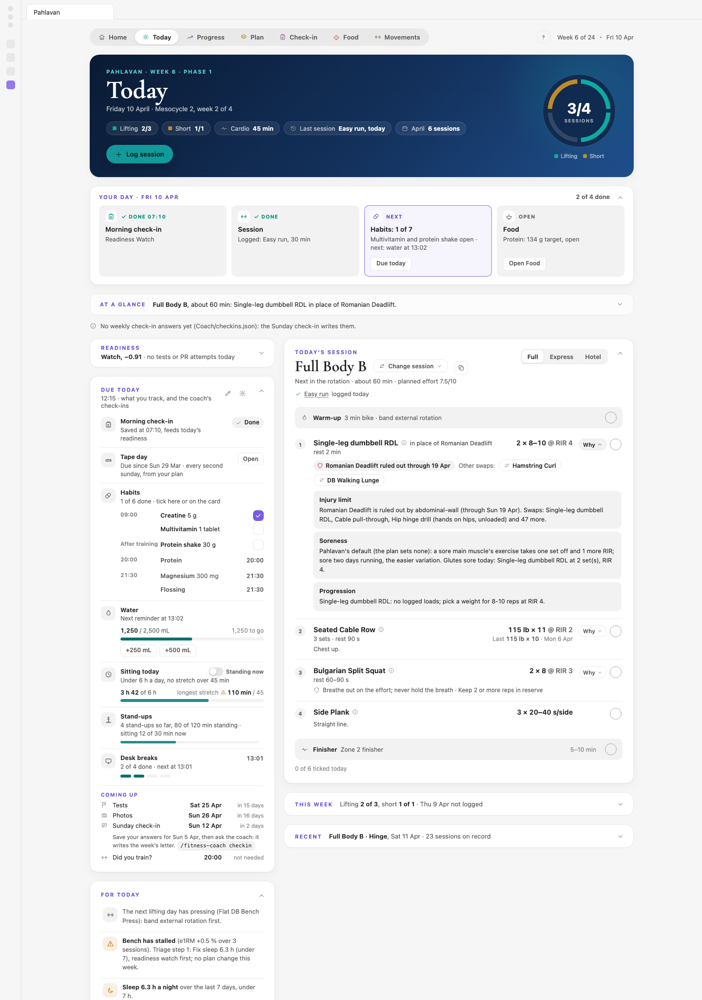

- **The banner** names the week (for example "Week 6 · Phase 1", or the phase's name), the block and the week inside it ("Mesocycle 2, week 2 of 4"; hover it for what a mesocycle is), this week's sessions done against the plan, and your last session. The ring fills one segment per session done.
- **Your day**, under the banner, is your day with Pahlavan in one row: "Your day · Wed 4 Nov" and how many steps are done ("2 of 4 done"). The steps are the **Morning check-in** (done with the time you saved it and your readiness, or **Open** for its card), the **Session** (today's planned session and its minutes with **Log session**, or what you logged; a rest day counts as done), **Habits** ("3 of 6" of today's supplements, ticks and amounts, the evening ones too, what's open now and the next card, such as "next: water at 13:00"; **Due today** takes you to the tick boxes), and **Food** (the protein tick: "Protein ticked" or "Protein: 134 g target, open"; **Open Food** opens the Food tab). On a Sunday a fifth step is the **Sunday check-in**, then the coach: **Open check-in** while the questions wait, then the command with **Copy** once they're saved. The step that comes next has a coloured border and says **Next**; hover a step's word for why. Without an eating plan or a protein item, Food shows "No plan yet" in grey and doesn't count.
- **Readiness** compares this morning with your usual and says what that changes. See [Readiness and its bands](#readiness-and-its-bands).
- **Due today** lists what you track and the coach's check-ins, with tick boxes and quick buttons.
- **For today** lists what to watch: a stalled lift, short sleep, a light week coming, a temporary change.
- **Today's session** is the session to do, already adjusted for your readiness, your sore muscles and your Ledger.
- **This week** shows each day, and **Recent** your last four sessions.

During the session, the circle at the end of each exercise ticks it done; the Log panel starts from those ticks. To take the session to the gym, the copy button next to the session's name copies today's plan as plain text, ready to paste into a note on your phone.

### Log a session

After training, press **Log session** in the banner. The Log panel slides in, filled in from today's session: its exercises, their targets and your last numbers. You only change what differed.

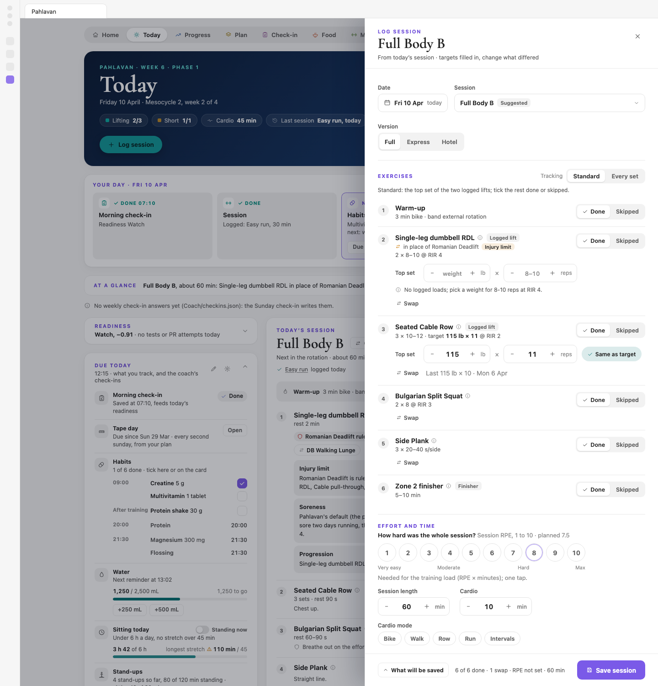

1. Check the **Date**, the **Session** and the **Version** (Full, Express or Hotel). For anything outside the plan (a hike, a match, yoga), pick **Something else** in the Session menu. Changing the date rebuilds the panel from that day's plan (its session, sets and ladder levels; a session already logged that day opens for editing), and keeps what you already entered where the same exercise is there: done or skipped, a swap, the top set and the sets, and your effort, minutes and notes.
2. Under **Exercises**, every item starts as **Done**. If you ticked items on Today during the session, the panel starts from your ticks instead: what you ticked is **Done**, the rest **Skipped**, and a line says so ("From your ticks on Today: 4 done, 2 skipped"). Mark anything else you didn't do as **Skipped**, and say why if you like (Time, Pain, Equipment, Energy).
3. For each **Logged lift**, enter the top set: its weight and reps. **Same as target** fills in the target for you. Did a different exercise? Use **Swap** under it. A swap you chose on Today's chips is already in place, marked **Your swap**.
4. Want to log every set? Switch **Tracking** from **Standard** to **Every set**, then enter the weight, reps and, if you like, the reps in reserve for each set.
5. Under **Effort and time**, tap how hard the whole session felt, from 1 to 10 (the **session RPE**), and set **Session length**, **Cardio** minutes and the **Cardio mode**.
6. Under **How it went**, which is optional: any pain or niggle, sore muscles on the body map, a **Session rating**, and **Notes**. A pain you log comes back: over 3 of 10, Today's **Data notes** say so for a week, and the Sunday check-in shows it.
7. Press **Save session**.

Before you save, **What will be saved** at the bottom shows the exact entry. Saving also ticks the Workout habit in your habit check-ins.

Got something wrong? Click the day in **This week**, or the session under **Recent**, to open it again. Change what you need and press **Save changes**, or use **Delete session**, which asks first.

### Tick habits and answer the reminder cards

Through the day, cards pop up for what you track: a supplement at its time, water every couple of hours, a stand-up after a long sit, a desk break. Each card says why it came. Answer it, snooze it, or close it with the ×, which counts as a snooze. [Reminder cards](#reminder-cards) describes each one.

You don't have to wait for a card. **Due today** on Today lists the same things: tick a supplement, add water with the quick buttons, or click a row's name to open its card.

In the evening, if your plan had a session and nothing is logged by 20:00 (or the time you set in Settings), **Did you train today?** asks. Choose **Log session**, **Rest day** or **Not today**.

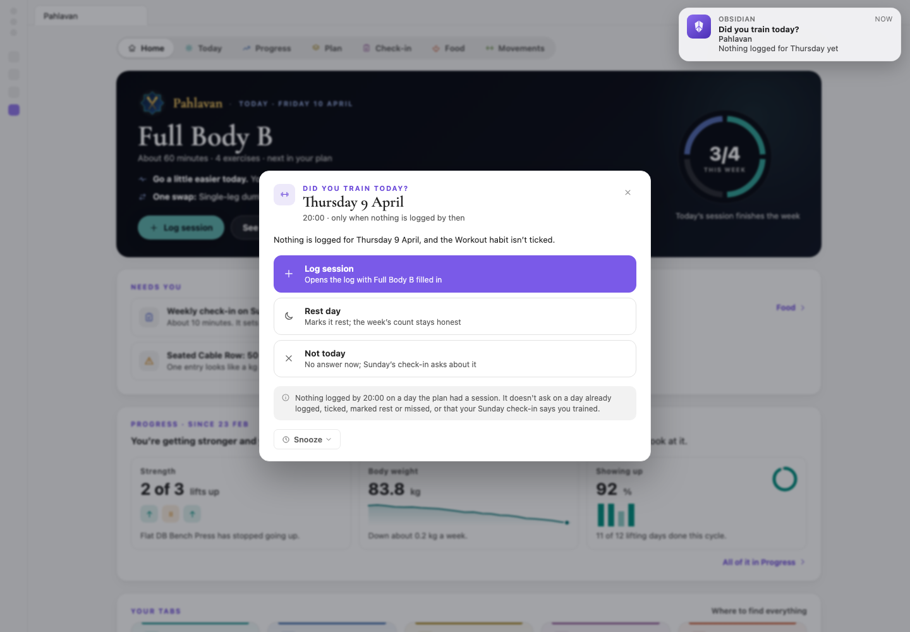

### On a short or unusual day

The **Full**, **Express** and **Hotel** buttons on Today's session rebuild the session in place:

- **Express** is the short version for a busy day, about 20 minutes: a short warm-up and the main lifts at fewer sets.
- **Hotel** is for travel: the same session with bodyweight, dumbbells and bands only.

**Change session** lets you do any session in your plan today; **Back to the suggestion** undoes the choice. The next day, the plan's usual order is back.

When your Ledger rules an exercise out, Today does another in its place and offers **Other swaps** as chips. Click one to do it instead today: the chip is marked, the Log panel starts with it, and clicking it again undoes it. Nothing is logged until you save the session.

Some weeks go wrong. Your plan has a **minimum week**: the least that keeps you on track in a bad week, every lifting session as Express (the main lifts at two working sets, about 20 minutes), with the short sessions and cardio optional. The Plan screen shows it in its **The minimum week** card. The minimum week beats skipping the week. For anything bigger, such as travel, an ache or several missed days, tell the coach: "I'm travelling next week", "my knee hurts on lunges".

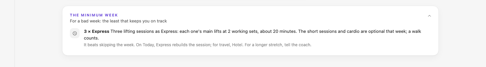

## Your Sunday check-in and letter

Every Sunday you review the week with the coach. It takes under five minutes, in two halves.

**First, answer the questions in Pahlavan.** On Sunday the Check-in banner shows **Start the Sunday check-in**. The questions are built from your log, and only the ones your data can't answer are asked:

- **Anything you did that isn't logged?** Each day without a session offers **Trained, not logged**, **Rest** or **Missed**. A blank day never counts as rest or missed until you say so.
- How hard the week felt, any pain or niggle (on a body map; the question shows what your logs already say, such as "Logged: knee 4 of 10 during Goblet Squat, Wed."), how the week went outside training, whether you recovered by the next session, and how many more clean reps your top sets had left.
- Your protein days (if you track protein): on how many of the days you didn't tick did you still reach your floor? There's one button per day, from 0 to the number of unticked days. While today's protein tick is still ahead (its card comes in the evening), today isn't asked about: the question says "the other 2 before today", and the tick counts by itself when you make it, so nothing is counted twice.
- How much you looked forward to sessions, and anything different in the weeks ahead (tap the first and last day of a trip or a busy patch).
- Whether you followed the last letter's focus, its question, and any notes for the coach.

**What the coach will save** sums up your answers. Press **Save**. You can save with some answers still open and add them later: the card then offers **Change the answers**, with every answer you gave still there to change. If you missed Sunday, the banner offers **Finish last Sunday's check-in** the next day.

A day you mark **Trained, not logged** shows as that on Today's week strip, and the evening **Did you train today?** card doesn't ask about it. Log the session later and the day turns **Trained**.

**Then get your letter.** In Claude Code, type:

```
/fitness-coach checkin
```

The coach reads your saved answers (and asks only what's still open), works out the week's numbers, and proposes up to three changes for next week, each with its reason. You choose which to make. Then it writes the letter into `Coach/Letters/`: what happened, next week's targets, what changes and why, one focus for the week, and one question for you. The letter shows on the Check-in screen under **Last letter**, and next Sunday's check-in asks about its focus and its question.

You can also do the whole check-in in Claude Code: when nothing is saved yet, `/fitness-coach checkin` asks the questions itself. Mid-week, "what should I lift next week?" gives just next week's targets.

Pahlavan tells you what to run. Before you save, the Sunday check-in says **Save your answers, then ask the coach** with the command. Once they're saved it says **Next: ask the coach**, and Today shows an **Ask the coach** card with the step (the week's letter, or a review), the command and a **Copy** button. If no letter is in by 18:00, an **Ask the coach** reminder card comes, and once a day after that until the letter is in or the next Sunday comes. See [When to talk to the coach](#when-to-talk-to-the-coach).

## The light week, every four weeks

Every fourth week of the plan is a **light week** (the training rules call it a deload): two sets of everything, about 10 % lighter, so your body can catch up with the training. It isn't time off. The Plan screen marks it with an L.

The light week is also when you measure:

- **Tape:** waist, hips, chest and arm, every second Sunday, so one tape day falls in each light week. A **Tape day** card comes with the morning check-in.
- **Progress photos:** on each light week's Sunday, so every four weeks, the same four poses as before (front, side, back and the posture close-up). The **Photo day** card takes them by drag and drop and converts iPhone photos.
- **Fitness tests:** at the end of each phase, every eight weeks, on the Saturday of the phase's last week: push-ups, pull-ups, holds, the wall test and a few more. The **Fitness tests** card takes them; leave any you can't do blank. Your intake's self-check results are on record already, so the first test day has numbers to compare with.

You can also open each of these from the Check-in screen's **Body record** card.

The check-in that ends a light week is the **mesocycle review** (a mesocycle is one 4-week block). Run:

```
/fitness-coach review
```

The coach asks how each muscle group felt over the four weeks (barely worked, recovered in time, still sore, or a joint ache), asks for the result of your **RIR calibration set** (see [RIR](#rir-reps-in-reserve)), writes a dated progress report from your photos, tape and numbers, and proposes next month's plan. On your yes, it builds it.

At the end of each phase (weeks 8, 16 and 24), the **phase review** takes its place: the tests, the photos again (with the movement photos), what was predicted against what happened, what to keep, change or try, and the plan for the next phase. At the plan's last week (week 24) it also plans the next cycle with you.

The Plan screen's **Coming up** names the step after each Sunday's check-in, with its command, and so does each week in the plan's calendar.

## The screens

The five tabs sit at the top of Pahlavan, with the **?** (help), the plan week and the date on the right. The week counts against the plan's length ("Week 6 of 24"; past its end, "Week 26, after the plan's 24"). Each screen opens with a banner: the week and phase, the screen's main numbers as small pills, its main action, and a ring. Under it, **At a glance** sums the screen up (see [At a glance and folding](#at-a-glance-and-folding)). Hover almost anything for details: most cards also have a **Table** button that shows the same numbers as a table.

### At a glance and folding

Under each banner, **At a glance** gives two or three lines on where things stand (today's session, what's still open and readiness on Today; the week, the waist and strength on Progress; and so on), and **What's on this tab**: one row per section, top to bottom, with a line on what it shows. Click a row to go to that section; if it's folded, it opens. **Open all** and **Fold all** do every section of the tab at once, and the chevron folds the panel itself to one line. The panel is open for your first three visits to a tab, then folded; once you open or fold it yourself, it stays that way.

Every section card folds too. The chevron in its top-right corner folds it to one line: its name and its status in plain words, such as "This week: Lifting 2 of 3, short 1 of 1". Click the line to open it again. Each tab starts with what you need now open and the rest folded:

- **Today:** Your day, Today's session, Due today and For today open. Readiness is folded to its one line, unless it changes the session (Low, a trim, an early light week or no hard training) once its baseline is built. This week and Recent are folded.
- **Progress:** on Overview, Strength trends, Weight trend and Consistency open; Weekly sets per muscle and Readiness folded. A folded card keeps its place, so nothing moves when you open it. The other views start open, and the panel's buttons switch between them.
- **Plan:** This mesocycle and Coming up open, side by side; the rest folded beside and under them.
- **Check-in:** whatever is due is open: the morning check-in until you've done it, the Sunday check-in on Sundays (or while last week's is unsaved), and the body record when a part is due within three days. The rest, the last letter too, is folded.
- **Food:** A day on your plan, Today and Coach's tips open; Your plan in a minute open for your first few visits, then folded; How it's going folded.

A section with something due opens on a new day even if you folded it before. Your choices live in `Coach/help.json` in your vault, so both computers show the same.

### Today

- **Banner:** the **Lifting** and **Short** sessions done this week against the plan (short sessions are the plan's shorter days, such as skills, mobility or conditioning), **Cardio** minutes, your **Last session** and the month's count; **Log session**; the **Sessions** ring, one segment per planned session (hover a segment to see which). The banner's colours follow the time of day.
- **Your day:** under the banner, above At a glance: the day's steps (the morning check-in, the session, habits, food, and on Sundays the Sunday check-in), each with its state (Done, Next, Open), one line and one button; the steps wrap onto a second row in a narrow pane, and the card folds like the others (see [Read Today](#read-today)).
- **Welcome to Pahlavan:** in your first weeks, under the banner, until its six steps are done or you hide it (see [Help inside Pahlavan](#help-inside-pahlavan)).
- **Readiness:** the gauge from −2 to +2 with its four bands, today's band, and "Smoothed over 3 days. This morning on its own: …". Below it, the five inputs, each against **Your usual range** and marked **Worse**, **Usual** or **Better**; then **How this works** and what each band does to the session, with today's band highlighted. At the bottom, what changes today: **No change today** with "Train as planned", or an action such as "Train as planned, but no tests or PR attempts".
- **Due today:** the pencil opens Habits, the gear opens the reminder settings. The rows: the **Morning check-in** (Done, or **Open**); a tape, photo or test day when one is due; **Habits** by time slot, with tick boxes (a slot later in the day shows its time; tick it early on its card or in Habits); each amount with its bar and quick-add buttons; **Sitting today** with the **Standing now** switch; **Stand-ups** (how many so far, minutes standing and how many of them at the desk, this sitting stretch); **Desk breaks** (done of planned, the next time); and **Did you train today?** once it applies, with **Answer**. **Coming up** lists the next tape, photos and tests with their dates, the Sunday check-in, and the evening "Did you train?" card.
- **For today:** up to six things to watch: a stalled lift and its next step, sleep under 7 hours, the next light week ("Light week in 2 weeks"), a temporary change and when it ends. Otherwise, "Nothing to watch today."
- **Today's session:** its name; **Change session**; the copy button; **Full**, **Express** and **Hotel**. The line underneath says why this session ("Next in the rotation"), roughly how long it takes and its planned effort. A lifting day's length is your usual one from the log; a short day's is worked out from the plan (the cardio's minutes, each set and its rest), and when that runs over your short-day length the line says so ("about 33 min, 3 over your 30-minute short day"). A session already logged today shows as a link that opens it for editing. Then any notes for the day (such as the calibration week), the **Warm-up**, each exercise and the **Finisher**. For each exercise:
  - a name with an ⓘ opens its movement guide: what it works on a small body map, the setup, the movement, what to avoid, and a video;
  - the target on the right: "115 lb × 11 @ RIR 2" means 115 lb for 11 reps, stopping with about 2 reps left; "3 × 8–10 @ RIR 3" means 3 sets of 8 to 10 reps;
  - **Last** shows your last top set and its date;
  - under the name, the rest the plan gives the exercise ("3 sets · rest 2–3 min"), and on a line of its own the plan's form cue for it, such as "Chest down on an incline bench." The cue leaves out what the row shows elsewhere: the reps in reserve and the progression rule are in the target, and the plan's reason is behind **Why**. An exercise whose note holds no cue has no cue line, and a swapped exercise has none (the cue is for the planned one);
  - a superset is two exercises done back to back: a set of one, a set of the other, then the rest. Its two rows are numbered as in your month plan, **4a** and **4b**, and drawn as one block, each naming the exercise it goes with ("with Leg extension · rest 90 s after each pair"). The circle on the first row ticks the pair. Express keeps only the main lifts, so it has no supersets;
  - a swapped exercise says "in place of" the planned one, with the reason (for example an injury limit from your Ledger), and **Other swaps** you can choose for today;
  - **Why** opens the reasons behind the line: first **From the plan**, the plan's own reason for the exercise, then the engine's: the progression rule, soreness, an injury limit, a readiness trim. The finisher has its own **Why** when the plan gives it a reason;
  - the circle ticks it done.
- **This week:** each day is **Trained** (with the session's name), **Rest**, **Not logged** (the Workout habit ticked but no session logged), **Trained, not logged** (your Sunday check-in says you trained that day), **Missed**, **No entry** or **Upcoming**. Rest and missed days you give in the Sunday check-in show here too. "No entry" means nothing logged, ticked or marked, and it never counts as rest or missed: the Sunday check-in asks. Click a trained day to edit its session.
- **Recent:** a card of its own, folded at first: your last four sessions, each opening for editing, and **History: all N sessions**, which opens the Session History note.
- **Data notes:** if a file holds something odd, such as an unknown exercise name, a collapsed **Data notes** list at the bottom says what. A pain over 3 of 10 you logged in the last week is one note there too, with what the pain rule says to do: change the load, the range or the exercise, and tell the coach.

### Progress

Progress shows how the training is going over weeks.

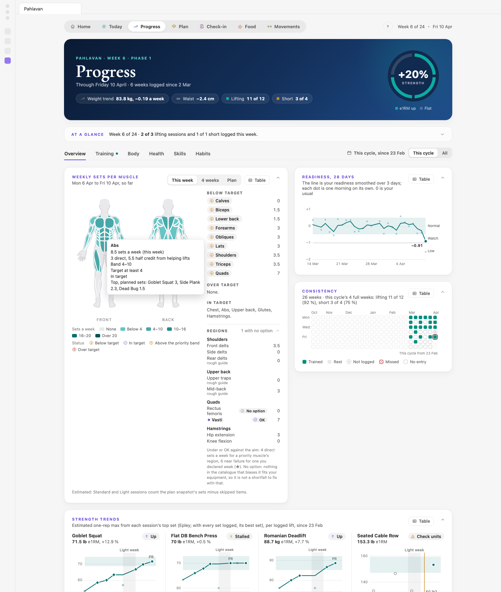

The banner shows your **Weight trend**, the change in your **Waist** (both in your units), **Lifting** and **Short** sessions done against the plan, and the **Strength** ring: the average change in estimated one-rep max across your logged lifts.

Under the banner are six sections: **Overview**, **Training**, **Body**, **Health**, **Skills** and **Habits**. On the right, the range switch: **This cycle** (the default, counting from the day your current cycle began, with its date) or **All** (earlier cycles too). Each section remembers its own choice, and nothing is deleted either way. Habits has no switch: each item counts from its own start.

- **Overview:**
  - **Weekly sets per muscle:** a body map shaded by hard sets a week, with **This week**, **4 weeks** and **Plan** views (early in a cycle, **4 weeks** reads **This cycle**), and the muscles **Below target**, **Over target** and **In target**;
  - **Readiness, 28 days** (or **Readiness, this cycle** in a young cycle): the smoothed line, with a dot for each morning on its own;
  - **Consistency:** 26 weeks of days as a calendar, with the same marks as This week;
  - **Strength trends:** your estimated one-rep max from each session's top set, per logged lift, marked **Up**, **Flat**, **Stalled**, **Down**, **Check units** (a weight that looks like the wrong unit) or **Too few sessions**, with records and light weeks shown;
  - **Weight trend:** daily weigh-ins, the smoothed trend, the change a week against your goal band, and the next three weeks at the current rate.
- **Training:** **Records and milestones** (each lift's best top set and the next round number), **Every lift** (each lift's estimated one-rep max session by session, with the change since week 1), **Sessions** (by plan week or by month: **Weeks** or **Months**) and **Cardio minutes**.
- **Body:** **Tape** trends (every second Sunday); **Targets** (body measures against the targets in your profile); and **Progress photos** (each light week's Sunday). Choose a **Before** and an **After** date and a pose, then view them **Side by side**, with a **Slider**, or as an **Overlay**, or scan the grid. On the keyboard, ← and → step through the After dates, and 1 to 4 pick the pose.
- **Health:** **Resting HR**, **Sleep** and **Steps** as 7-day averages against their goals, and a chart of each, day by day.
- **Skills:** each calisthenics ladder (see [Ladders](#ladders)) as a path of levels: **Mastered**, **In progress**, **Next: unlocked** and **Locked**. ▲ moves you up a level; ▼ moves you down, as a correction. Each ladder sits beside its latest test and goal. When a test shows you're ahead of your level, **Move to level N** appears. A level's name opens its movement guide.
- **Habits:** what you track. See the next section.

### Habits (in Progress)

Habits is where you choose what Pahlavan tracks and reminds you about. The coach can suggest items, but you decide.

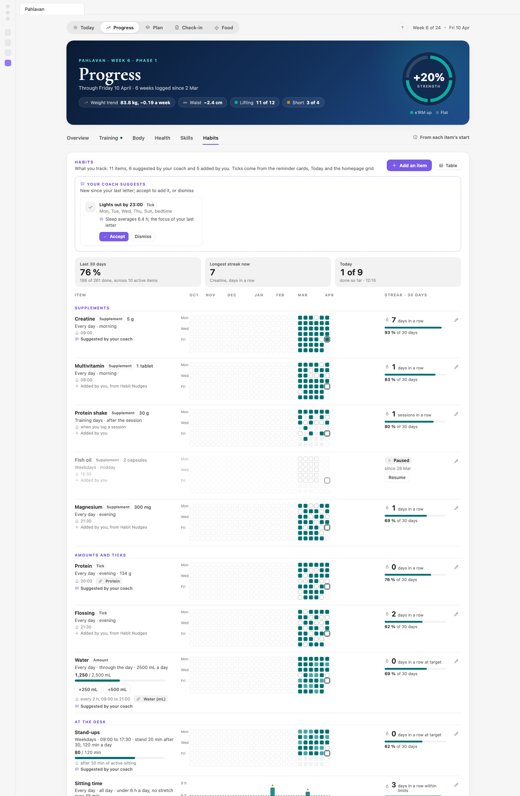

- **Add an item:** pick a kind. **Supplement** is something you take, with a dose (creatine, a multivitamin). **Amount** is a daily target you add to (water). **Tick** is done or not (flossing). **Stand-ups**, **Desk breaks** and **Sitting time** are the desk kinds. Then give it a name, a schedule, a reminder (or none), a start date, an optional **Linked habit** (its ticks then also go to that habit in your habit check-ins, which another habits page can show), and a note. Press **Save**.
- **Each row** shows the item's kind and dose or target, its schedule and reminder, any linked habit, who added it (**Suggested by your coach**, with the reason on hover, or **Added by you**), a 26-week grid, the streak, and the share of the last 30 days done. **Sitting time**, **Stand-ups** and **Desk breaks** show their last 4 weeks as a bar a day instead of the grid: the minutes sitting against your limit, the minutes standing against your target (the minutes at the desk, with **Standing now** on, the darker part at the bottom), and the breaks done against the ones planned. Hover over a day for its numbers. The pencil opens its form. Changes apply from today; the past stays as it was. In the form, **Pause it** and **Resume it** keep the history; **Remove** asks first, and a linked habit keeps its own ticks.
- **Your coach suggests:** items the coach proposed, each with its reason. **Accept** adds it with those settings (you can change them later). **Dismiss** declines it, and the coach won't suggest it again without new data.
- **The tiles:** **Last 30 days**, **Longest streak now** and **Today**.
- **Today's reminders:** the day's cards, in order.
- **Bring over from Habit Nudges** appears once, only if you use the Habit Nudges plugin and haven't brought anything over: tick what Pahlavan should take over, or choose **Not now** or **Start fresh instead**.

### Plan

The Plan screen shows the whole plan and where you are in it.

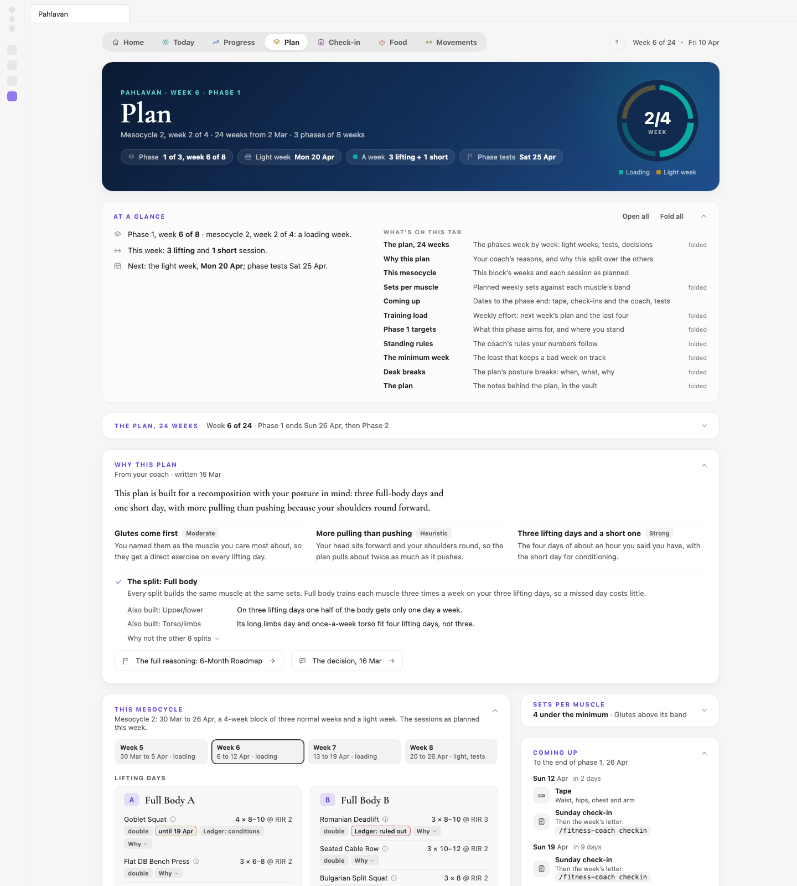

- **Banner:** the block and week ("Mesocycle 2, week 2 of 4"), the **Phase** and your week in it, the next **Light week**, **A week** (the sessions the plan asks for each week, and the minimum week on hover) and the next **Phase tests**. The ring shows your week inside the current block.
- **The plan, N weeks:** a timeline with the phases, the 4-week blocks (mesocycles) and every week: **C** marks the calibration week, **L** a light week and a flag the tests. A line marks today. Below the weeks: **Decisions** (diamonds: hover one to see what changed, why, and when it will be checked), **Busy weeks** from your check-ins, and **Limits** (your Ledger's limits and temporary changes, with their end dates).
- **This mesocycle:** the four weeks of the current block, and each session's exercises with their sets, reps and RIR. Small tags say how each exercise moves on: **double**, **linear** or **ladder** (see [Key ideas](#key-ideas-in-plain-words)), **until** a date for a temporary change, and **Ledger: ruled out** or **Ledger: conditions**. **Why** after the tags opens the plan's reason for the exercise. A name opens its movement guide. Each short day's panel says about how long it takes ("about 33 min", from its cardio minutes, sets and rests), and **N min over** when that runs over the short-day length in your profile; hover it for what takes the time.
- **Sets per muscle:** the sets a week the plan gives each muscle, against the bands (under 4 is below the minimum; a priority muscle aims for 10 to 16). A priority muscle's row also says how many of its sets are direct and near failure, for example "22.5 · 12 direct, near failure": only those count toward its 10. A set is near failure at RIR 3 or less; a hold when its longest time is at least 75% of your tested best (a rule of thumb); an exercise below your level on a ladder never is; and the half sets an exercise gives the muscles it only helps do not count. A row with fewer than 10 is flagged **Too few direct sets near failure**. The line under the chart compares the week's pulling sets with its pushing sets: with a posture emphasis your plan aims for about 2 to 1 and holds at least 1.8.
- **Phase targets** (titled with the phase, for example "Phase 1 targets"): each target with its baseline, the predicted value by the phase's end, the current value and a status (**On track**, **Ahead**, **Behind**, **Not measured yet**). **Heuristic** marks a prediction that is an estimate, not a promise.
- **Training load:** next week as planned, beside the last four. Load is session RPE times minutes.
- **Coming up:** the dates to the end of the phase: tape, Sunday check-ins, the light week, tests, photos, the phase review.
- **The minimum week:** the least that keeps a bad week on track (see [On a short or unusual day](#on-a-short-or-unusual-day)).
- **Desk breaks:** the plan's short posture routine during the working day, how often and between which hours, with **Change in Habits** or **Add in Habits**; or "No desk breaks in this plan". The times come from your plan, which the coach fits to your working day (for 9 to 5, every 90 minutes from 09:00, the last break at 16:30). A plan that doesn't set them uses every 90 minutes from 10:00 to 15:00 on weekdays. A desk-break item with **Follow the plan** on (in its Habits form) runs on the plan's routine and times; turn it off to keep your own.
- **The plan:** links to the notes behind the plan that exist in your vault, such as the roadmap, this month's plan, the Exercise Guide, Session History and the baseline note.

### Check-in

The Check-in screen holds your morning check-in, your body record, the Sunday check-in and the last letter.

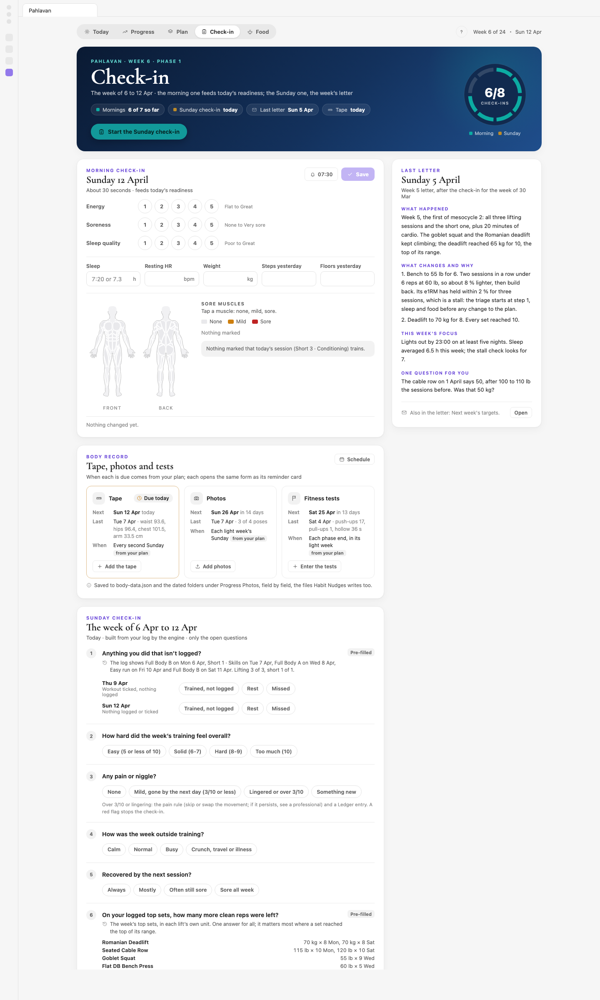

- **Banner:** **Mornings** saved this week, the **Sunday check-in** (today, in N days, or saved), the **Last letter** and the next **Tape** day. The button changes with the day: **Start the Sunday check-in**, **Finish last Sunday's check-in**, **Sunday check-in saved**, or **Sunday check-in opens Sun**. The ring counts this week's check-ins.
- **Morning check-in:** the same questions as the card (Sleep takes "7:20" or "7.3" here too, and the weight is in your units), plus a **Sore muscles** body map (tap a muscle: none, mild, sore) that says whether today's session trains what you marked. The bell button shows the card's time (for example "07:30", or **Off**): click it to change the time or turn the morning card off, then **Save**. The line at the bottom lists what will change; press **Save**.
- **Body record:** the **Tape**, **Photos** and **Fitness tests**, each with when it's **Next**, the **Last** entry, and **When** it comes ("from your plan"). **Add the tape**, **Add photos** and **Enter the tests** open the same forms as the reminder cards. **Schedule** switches between **From the plan** and **Every N days** from a start date (for before you have a plan); each part then says "from your plan" or "your own schedule".
- **Sunday check-in:** "The week of … to …", the questions your data can't answer (and, once saved, your answers to change), and **What the coach will save** with its **Save** button. See [Your Sunday check-in and letter](#your-sunday-check-in-and-letter).
- **Last letter:** the coach's latest letter: **What happened**, **What changes and why**, the week's focus and its question. **Open** shows the whole letter.

### Food

The Food tab draws your eating plan day to day, once the coach has written one (`/fitness-coach diet`). Until then it says "No eating plan yet", with the command to copy and what the tab will show.

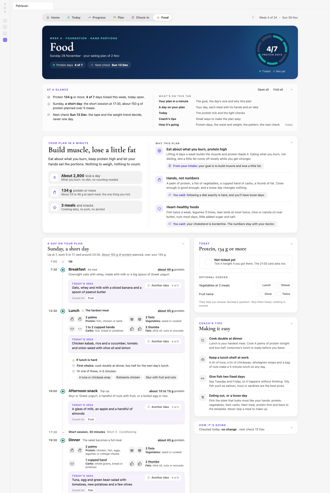

- **Banner:** the plan's level (**Hand portions**, **Protein and calories** or **Every macro**, the level you chose with the coach), this week's **Protein days** and the plan's **Next check**. The ring fills one segment per day you reached your protein floor this week.
- **Your plan in a minute:** your goal in plain words, the approach in a sentence, and three facts: about how much energy a day (what you burn; at the Light level nothing is counted), your protein floor ("134 g protein or more") and your meals. Beside them, **Why this plan**: each reason with where it comes from, **From your intake** or **You said**.
- **A day on your plan:** your day as a timeline, from getting up to bed, with today's kind of day from your plan ("Monday, a lifting day"). Each meal shows its time and its rough protein, and lunch and dinner their hand portions: palms of protein, fists of vegetables, cupped hands of carbs and thumbs of fat, each with its foods. Your own hand sets the size, so nothing is weighed. Under a meal, **Today's idea** is one concrete meal that fits, with **Counts for** when it helps the weekly pattern (fish, legumes); **Another idea** shows the next one, for now only (tomorrow brings the next idea by itself). The hardest meal has its fallbacks: the first choice and a few quick ones. On a lifting day your session sits at its time and the snack says to have it 1 to 2 hours before you train; a short day shows the short session instead. The line at the foot lists the day's drinks.
- **Today:** the protein tick (**Not ticked yet**, or **Reached today**; it ticks the same Protein item as Due today and its reminder card), then the **Optional checks**, such as vegetables at lunch and dinner and fruit twice. They're never scored or tracked: they only help with Sunday's pattern question, where a line you checked on most days of the week starts as **Met** (change it if it's wrong).
- **Coach's tips:** three or four tips from the coach that make the plan easy, such as cooking double at dinner for the next day's lunch.
- **How it's going:** one card, folded at first to a line such as "Week 1, too early to judge · next check 29 Nov". Open, it shows this week's protein days, the waist and the weight trend against the plan's direction (with a **Table** of the numbers), the weekly pattern as you answered it on Sundays, and the next check. The tape every second Sunday and the weight trend decide, never one day: the waist flat for four weeks with the trend not falling takes one cupped hand of carbs less a day; losing faster than 1 % of your body weight a week gives one back. One step at a time, then a few weeks' wait; creatine's water in its first weeks takes no step.

Until the coach adds your day's times, the meal ideas, the reasons and the tips, the tab shows what your plan holds: the meals in order without times, and no ideas, checks or tips. Hover any number for where it comes from. The coach reviews the plan on its check date and after each tape day; to change it sooner, tell the coach ("lunch is hard this month").

### Settings

Pahlavan's tab in Obsidian's settings holds only what applies to every reminder. Each item's own reminder is set in Habits, the morning check-in's time on its card in Check-in, and the tape, photo and test dates in the Body record. The note at the top links to each of these. Above it, **New to Pahlavan? Read the user guide** opens this guide, and **Show the first-run tips again** brings the tips back.

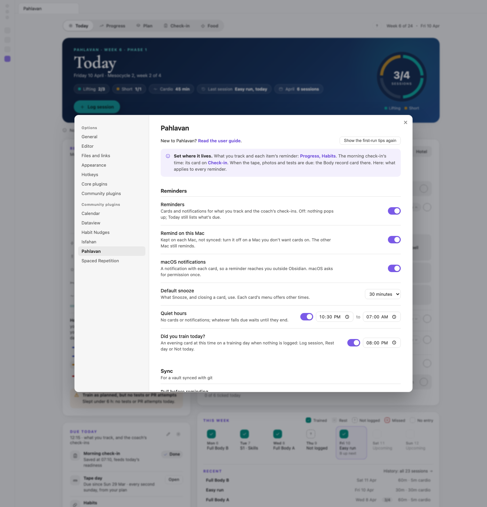

- **Reminders:** cards and notifications on or off. Off, nothing pops up, and Today still lists what's due.
- **Remind on this Mac:** kept on each computer, not synced. Turn it off on a computer where you don't want cards.
- **macOS notifications:** a notification with each card, so a reminder reaches you outside Obsidian. macOS asks for permission once.
- **Default snooze:** what **Snooze** and closing a card use: 10 minutes, 30 minutes, 1 hour or 2 hours.
- **Quiet hours:** no cards or notifications between two times (22:30 to 07:00 at first). A card due early in the morning waits until they end; one due late in the evening is skipped that day. Hours that start before 18:00 also hold the **Ask the coach** card, whose time is fixed: end them earlier or start them later to have it.
- **Did you train today?:** the evening card on a training day when nothing is logged, and its time (20:00 at first).
- **Sync** (for a vault synced with git through the Git plugin): **Pull before reminding** fetches the other computer's changes before a card shows; **Sync after saving** commits and pushes a minute after you answer a card. **Shared state** shows the file where snoozes, skips and answers live.
- **Phone, Import phone entries:** saves what your phone sends into the inbox (see [Logging from the phone](#logging-from-the-phone)); on at first. **Phone inbox** shows its folder.
- **Coach:** whether the coach (the Claude Code skill behind `/fitness-coach`) is set up in this vault, and the button that sets it up or updates it: it writes the coach into `.claude/skills/fitness-coach/` and touches nothing else. Files there that differ from Pahlavan's copy need a second click before they're replaced. **Node** says whether Node 18 or later was found: the coach's engine runs on it (install it from nodejs.org if it isn't). The command palette has **Set up the coach** too.
- **Files:** the **Fitness folder** (`Fitness` at first) and, when another habits page owns them, the **Habit check-ins file**. Changing the folder moves nothing: move it first, then change this. A vault that already kept its files elsewhere is found on the first start, and saved here.
- **Help, User guide address:** where **User guide** goes when your vault has no copy of this guide (`Fitness/Pahlavan guide.md`): the published guide at first.

## Help inside Pahlavan

Pahlavan explains itself as you go, in three places.

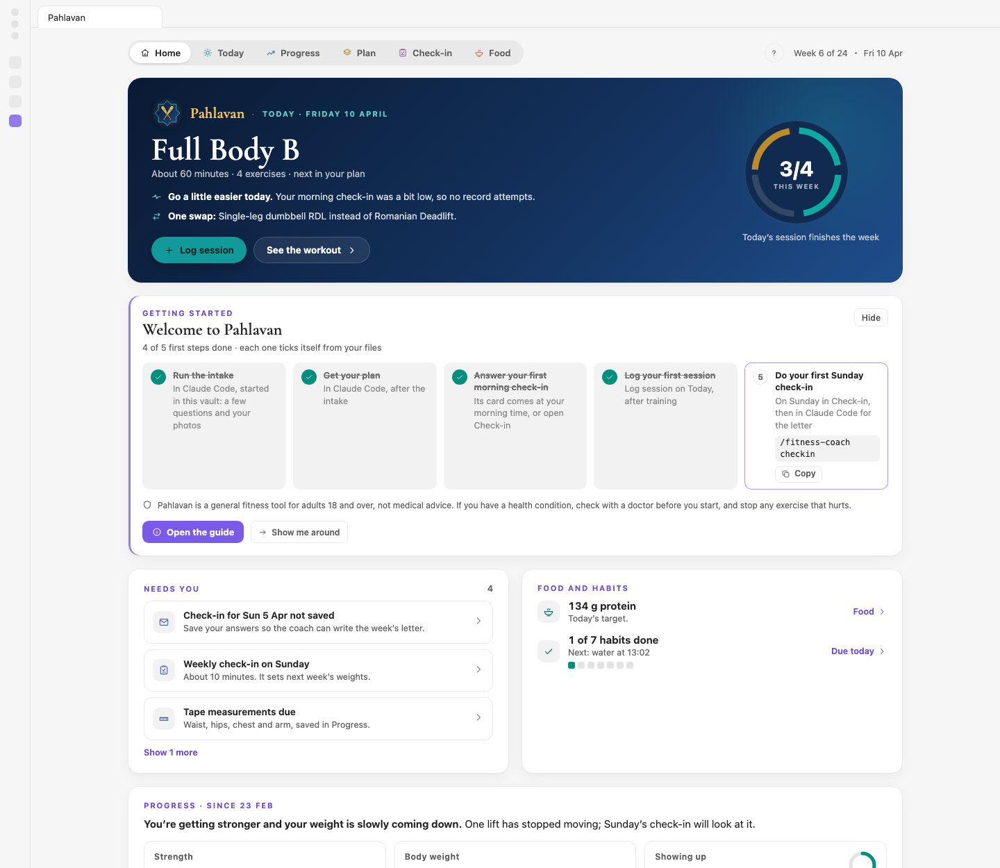

- **The ?** at the right of the tab bar has **User guide** (this guide: your vault's copy when there is one, else the published page), **Show the tips again**, **When to talk to the coach** (the list below, in short) and **Your routine**. The command **Pahlavan: Open the user guide** does the same as User guide.
  - **Your routine** is your own routine on one page: "About five minutes a day in Pahlavan, plus the session." Each row is a time, what to do and where you do it (a card, Today, Log session, Check-in, the Body record or the Plan). **Every day:** the morning check-in at its card's time (energy, soreness, sleep, and the numbers from your watch or phone if you have them, typed in), a look at Today, each thing you track at its card's time (times close together share a row, such as "21:00 to 22:00 Protein, flossing, skin routine"; water, stand-ups, desk breaks and sitting by the days they run; anything without a time under "Any time"), logging after training, and the evening "Did you train?". **Sundays:** the week's questions, then `/fitness-coach checkin` for the letter, and the tape every second Sunday with its next date. **Every four weeks:** the light week (its Sunday's photos, then `/fitness-coach review`) and the phase end (the tests on Saturday, the review on Sunday), each with its next date. It's built from your plan, what you track and your card times each time you open it, so it changes when they do.
- **The welcome card** sits at the top of Today in your first weeks, with six first steps: set up the coach (its button writes the coach, a Claude Code skill, into the vault, and says if Node is missing), run the intake, get your plan, answer your first morning check-in, log your first session, and do your first Sunday check-in. The steps done in Claude Code show their command with **Copy**. Each one ticks itself when its file appears, so there's nothing to tick by hand. **Open the guide**, **Show me around** (the tips, from the start) and **Hide** (any time) sit at its foot. Once all six are done, it goes.
- **Six one-time tips** point at the controls you need first: Readiness, Why, Log session and Due today on Today, the Sunday check-in on Check-in, and the This cycle switch on Progress. One shows at a time, beside its element, the first time its screen opens; **Got it** moves to the next, **Skip the tips** ends them. A tip waits while a reminder card or the Log panel is open.

Which tips you've seen and whether the welcome card is hidden live in `Coach/help.json`, so two computers that share the vault show each tip once. The same file keeps At a glance and the sections as you opened or folded them, and the Food tab's light checks.

## Reminder cards

### When a card comes

Pahlavan checks every minute whether a card is due. A card appears when:

- **Reminders** and **Remind on this Mac** are on, and it isn't quiet hours;
- no other card is open;
- you've used the keyboard or mouse in the last five minutes, so cards don't pile up while you're away.

The first check comes 20 seconds after Obsidian starts. When you close a card, the next due one follows a few seconds later. With **macOS notifications** on and Obsidian in the background, a notification comes with the card; click it to bring the card forward.

Each card has a line with an ⓘ that says why it came, for example "Daily at 07:30, the time on its card in Check-in."

### The cards

| Card | When it comes | How you answer |
|---|---|---|
| Morning check-in | At your morning time, until 21:00. On a tape day, the tape joins it. Sore today's quick pick is on it. | **Save**, **Skip today**, **Snooze** |
| Tape day | On tape days, once the morning check-in is in | **Save**, **Not today**, **Snooze** |
| Morning, Midday or Evening habits | At each item's time; items due at the same time share one card | Tick each item or **Tick all**, then **Save**; **Skip today**; **Snooze** |
| After the session | Once a session is logged, for items you take after training | As above |
| An amount, such as Water | At its interval from its start time, until you reach the target or its end time | Quick-add buttons, or type **Another amount** and **Add**, then **Done**; **No more today**; **Snooze** |
| Stand-up | After your set minutes of active sitting | **I'm standing**, or **Snooze**. It can't be closed: it says **Stays open**. |
| Sitting time | At your daily sitting limit, and once per stretch at your longest-stretch limit | **OK**, **Skip today**, **Snooze** |
| Desk break | At each break time in your working window | **Done**, **Skip today**, **Snooze** |
| Photo day | On photo days, once the morning check-in is in | Drop a photo on each pose, then **Save photos**; **Not today**; **Snooze** |
| Fitness tests | On test days, once the morning check-in is in | **Save** (leave tests you can't do blank); **Not today**; **Snooze** |
| Did you train today? | At its time (20:00 unless you change it in Settings), if the plan had a session and nothing is logged, ticked or marked rest or missed, and your Sunday check-in doesn't say you trained | **Log session**, **Rest day**, **Not today**, **Snooze** |
| Ask the coach | At 18:00 on a Sunday once your check-in answers are saved and no letter is in yet, then once a day until it is | **Copy** the command, **OK**, **Skip today**, **Snooze** |

### Snooze, skip and close

- **Snooze** opens a menu: 10 minutes, 30 minutes, 1 hour or 2 hours (your default is marked), **This evening, 18:00** before 18:00, and **Tomorrow morning** on the tape, photo and test cards. Water-style amount cards offer 30 minutes, 1 hour or 2 hours.
- **Skip today** answers the card for the day. **No more today** stops a repeating card until tomorrow. **Not today** on a tape, photo or test card leaves it for another day and asks again.
- On tape, photo and test cards, the Snooze menu also holds **Skip this tape day**, **Skip this photo day** or **Skip this test day**, with the date of the next one.
- The **×** closes a card and counts as a snooze.
- A card you open by hand when it isn't due says so: "Tape" with its next due date, and **Cancel** instead of Skip and Snooze. Closing it writes nothing.

### Stand-ups, sitting time and Standing now

Stand-ups and sitting time count only real time at the keyboard or mouse. Time away ends a sitting stretch and resets the stand-up count.

- **The stand-up card** says how long you've been sitting and asks you to stand for a while. After **I'm standing**, it counts down your standing minutes. You can close it and the count goes on in the status bar. Walk away from the desk if you like: time away during a stand counts as standing, so the stand finishes and counts. **End this stand** stops early.
- **The status bar** shows the next stand-up ("Stand in 12 min", "Stand up now", "Standing, 18 min left") while a stand-up or sitting item counts today; with Standing now on, the standing minutes until the next stand is logged for you ("Stand logged in 9 min"; nothing asks you to stand).
- **Standing now** is for a standing desk: while it's on, typing doesn't count as sitting, and standing at the desk counts toward your stand-ups. Each stand's worth of minutes (15 with the usual settings) is logged as a stand, quietly, and the sitting count starts over; less than that when you turn it off is not logged, and the sitting count goes on where it was. These desk minutes count toward your daily target and its linked habit like any stand, and are also kept apart, so Due today shows them ("80 of 120 min standing, 40 of them at the desk") and the coach's reviews can tell them from the stands the card asked for. Turn it on with the switch in Due today's **Sitting today** row, by clicking the status bar, or with **Pahlavan: Standing now (on or off, this Mac)**. It turns itself off at midnight or after half an hour away.
- **Calls:** Pahlavan doesn't detect calls. A call with no typing for longer than the item's time away counts as time away, not sitting.

### Two computers

If you use Pahlavan on two Macs that share the vault:

- Answers, snoozes and skips are shared through `Coach/nudges.json`. Answer a card on one Mac and the other stays quiet once the change has synced. A card the other Mac answered while it was open here closes by itself.
- A card left open also closes by itself, with no snooze, once there is nothing left to ask: the day's session is logged (from **Log session**, the coach or your phone), its habits are ticked or the water reaches its target somewhere else, the morning check-in or that day's tape, photos or tests are in, or the coach's letter is in. One left open in the evening closes at midnight, quiet hours or not, because its day is over. A card you have typed or ticked something on stays open.
- **Remind on this Mac** is set on each Mac separately.
- With the Git plugin, turn on **Pull before reminding** and **Sync after saving**, so each Mac sees the other's answers in time.
- Stand-up counts are per Mac; sitting time adds up both Macs.

### Commands

Open the command palette and type "Pahlavan":

| Command | What it does |
|---|---|
| Open | Opens the Pahlavan tab |
| Open the user guide | This guide: your vault's copy when there is one, else the published page |
| Open check-in | The morning card until today's is saved, then the Check-in screen |
| Open the morning check-in | The morning check-in card |
| Add progress photos | The photo card |
| Enter the fitness tests | The fitness tests card |
| Open the reminder queue (what is due now) | Every card due right now |
| Standing now (on or off, this Mac) | Turns Standing now on or off |
| Stand-up: ask me now | Asks for the stand-up card now, instead of waiting for the sitting minutes |

## Logging from the phone

You can log the day from your iPhone without Obsidian on it. Shortcuts on the phone send each entry (a session, habit ticks, water, the morning check-in, the answer to **Did you train today?**) as a small file into your vault's private GitHub repository. The Git plugin brings it to your Macs, and Pahlavan saves it the next time it reads your files, the same way its own screens save it. The step-by-step Shortcuts recipes come in a later release; Pahlavan's side is ready for them.

### The inbox

The phone's entries arrive in `Fitness/Coach/Inbox/`, one file each, named by when it was sent and what it is (`2026-11-05T19-02-00-session.json`). You don't need to open them. Pahlavan looks there each time it reads your files: when a new file arrives, when it starts, and at the start of each day.

The folder also holds two files Pahlavan writes:

- `phone.json`, today's list for the phone: the habits due today and which are still open, water so far, your plan's sessions with their two logged lifts and your last top sets, the next session in the rotation, and the morning check-in's questions with their ranges. The phone reads it, so its lists match Pahlavan's. Pahlavan rewrites it a few seconds after something changes, and at the start of each day.
- `refused.json`, the entries Pahlavan couldn't save, each with its reason (below).

### What imports

| From the phone | Saved as |
|---|---|
| A session: which one (A to D, S1 to S3), the two logged lifts' top sets, the minutes, Express, a rating, notes | A logged session, as **Save session** in the Log panel saves it, with the Workout habit ticked |
| Habit ticks (Creatine, Flossing, Protein...) | Ticks, as on Due today, with the linked habit each one has |
| Water (+250 mL, or any amount) | Added to the day's total, and to its linked habit |
| The morning check-in: energy, soreness, sleep quality, sleep, resting heart rate, weight, yesterday's steps and floors | The morning check-in, as its card saves it: steps and floors go on yesterday, and the day counts as checked in |
| Did you train today?: trained, rest or missed | A rest or missed day, or the Workout tick for trained; the evening card doesn't ask again |

Each saved entry moves to `Inbox/applied/`, one folder per month, and a notice says so: "Pahlavan: 3 phone entries imported". An entry that is there already (a tick you also made on the Mac) moves along too, with nothing to change.

### When an entry needs a look

Pahlavan never writes over what you saved. It leaves an entry in the inbox, unsaved, when:

- the day holds something else already: the morning check-in has another energy, or the day is marked rest and the phone says trained;
- that session is logged for that day already;
- the item isn't tracked, or the session isn't in your plan;
- the day is in the future, or more than 14 days back (log those in Pahlavan, where the form shows what the day holds);
- the same entry came twice.

Today shows it in two places: **Due today** says "1 phone entry needs a look", with what it was and why, and **Data notes** at the foot of Today lists each one with its file name. Fix what it clashes with and it saves on the next refresh, or delete its file from the inbox if what's on the Mac is right.

With two Macs, only one saves each entry: the other finds it moved, or saved already. **Import phone entries** in Settings turns all of this off.

## The coach and its jobs

The coach is the `fitness-coach` skill in Claude Code. Start Claude Code in your vault's folder, then type `/fitness-coach` and a job, or just say what you want: "log my workout", "how is my training going?". The coach works out the job from what you say.

| Job | Use it | Say, for example |
|---|---|---|
| `intake` | The first time, or for a fresh start | `/fitness-coach intake`, "reset my training" |
| `plan` | After the intake, and whenever the plan should change: travel, soreness, a short day, an injury, missed weeks, the next month | `/fitness-coach plan`, "I'm travelling next week, hotel gym only", "my knee hurts on lunges", "only 20 minutes today", "swap the leg press" |
| `log` | To log from your own words or a pasted workout sheet, set a ladder level, or fix a top set | "did A today, squat 65×5, bench 30×8", "I'm on push-up level 3 now", "Tuesday's bench was 60 × 8, not 80 × 8" |
| `checkin` | Every Sunday, after saving your answers in Pahlavan; mid-week for next week's targets | `/fitness-coach checkin`, "what should I lift next week?" |
| `review` | The check-in that ends a light week, and the phase reviews | `/fitness-coach review`, "phase review" |
| `progress` | After new photos, or for a dated progress report | `/fitness-coach progress`, "check my progress" |
| `diet` | For an eating plan, or questions about protein | `/fitness-coach diet`, "what should I eat?" |
| `ask` | For questions about your own data | "am I on pace for my waist target?", "why is my bench down?" |

### When to talk to the coach

**On a schedule:**

- **Every Sunday, after you save the questions:** `/fitness-coach checkin`, for the week's letter.
- **Each light week's Sunday, and each phase end:** `/fitness-coach review`, for the review and the plan for what comes next.

Pahlavan reminds you of both: Today's **Ask the coach** card and, in the evening, a reminder card.

**Any time, in your own words.** Type `/fitness-coach` and say what's going on:

- pain or an injury;
- travel, a busy week or missed sessions;
- missing equipment, or a lift you can't do;
- a lift that stalled;
- a new goal;
- starting or stopping tracking something;
- a workout sheet to paste in;
- any question about your numbers.

How the coach works with you:

- **It shows you every change before it writes it,** and writes on your yes: one question for a batch, not one per change.
- **Its numbers come from the engine,** never from memory, and each comes with its reason.
- **Every plan change gets an entry in `Coach/Decisions.md`,** with the date to check whether it worked. The Sunday check-in looks back at it on that date.
- **A gap in your log means "not logged", not "didn't train".** The coach asks before treating a blank day as missed.
- **You decide.** It proposes and explains; it never pushes a higher logging or eating level than you chose.
- **Safety first.** Warning signs, such as chest pain or fainting, stop the coaching and point you to a doctor. Pain gets "skip or swap it; if it persists, see a professional." Food advice stays general wellness: a diet for a medical condition is for your clinician or a dietitian.

## Key ideas in plain words

### Readiness and its bands

Readiness asks: how does this morning compare with your usual? Each of the five inputs (energy, soreness, sleep quality, sleep and resting heart rate) is compared with your own mornings from this cycle, where 0 is your usual. The needle is their average, smoothed over three days so one bad night doesn't swing it. It needs at least three inputs, and 14 mornings in the cycle before it scores at all.

| Band | Score | What it does to the session |
|---|---|---|
| Good | +0.5 or more | Train as planned |
| Normal | −0.5 to +0.5 | Train as planned |
| Watch | −1.0 to −0.5 | Train as planned |
| Low | −1.0 or less | One set fewer per exercise and RIR +1, until it's back to Watch or better |

Only Low changes the session. Readiness scales a session; it rarely cancels one. A few safety rules sit beside it:

- resting heart rate 7 or more beats a minute over your usual, two days running, or illness: no hard training (easy cardio or mobility at most);
- under 6 hours of sleep: no tests or record attempts today;
- Low five days running with a falling strength trend: the coach offers an early light week, and you decide.

### RIR (reps in reserve)

RIR is how many more clean reps you could have done when you stopped a set. "@ RIR 2" means stop with about two reps left; RIR 0 means nothing left. Most targets sit between 1 and 3. People tend to guess too many or too few, so in the last normal week of each block the coach plans a **calibration set**: you say how many reps you think you have left, then keep going to find out. The difference corrects your targets from then on.

### Session RPE and training load

Session RPE is how hard the whole session felt, from 1 (very easy) to 10 (as hard as it gets). Times the session's minutes, it gives the **training load**, which the Plan's Training load card tracks week by week.

### Top set, logged lifts and e1RM

Your **top set** is your heaviest set of an exercise. At the Standard logging level, each lifting session has two **logged lifts** whose top sets you enter; their progress sets your next targets. **e1RM** (estimated one-rep max) turns a top set into the weight you could probably lift once, so sets with different weights and reps can be compared over time.

### The calibration week

Week 1 of a new plan, and the first week back after three or more weeks off, is a calibration week. For each exercise you find a load that leaves about three reps in reserve. Nothing progresses or stalls that week; from week 2 the targets build on what you found.

### Light weeks

Every fourth week is lighter: two sets of everything, about 10 % lighter. The training rules call it a deload; Pahlavan and this guide say light week. It gives your body time to recover and catch up with the training. It's also when you measure (tape, photos, and tests at a phase's end). If you're run down, the coach may offer one early, and a busy week next to a light week can become the light week. Either way, you decide.

### Ladders

For bodyweight skills such as push-ups, pull-ups, core work or single-leg work, the plan uses **ladders**: a series of harder variations. Instead of adding weight, you move up a level. Move up after you reach the top of the reps on every set, two sessions in a row. Your levels are in Progress, Skills, and a ladder line in your plan reads "(your level)".

### Double and linear progression

Most weighted exercises use **double progression**. Each has a rep range, say 8 to 10. Add reps from session to session; when every set reaches the top of the range, add the smallest weight step and go back to the bottom of the range. If a set falls under the bottom, hold the weight. Some beginner barbell lifts use **linear progression** instead: a fixed number of reps, and the weight goes up by one step each session you make them. The Plan screen tags each exercise **double**, **linear** or **ladder**.

### Stalls

A lift has **stalled** when its e1RM moves less than 2 % over three sessions. The coach then works through a list of fixes, one step a week, starting with sleep and food before it changes the plan. Today's For today card names a stalled lift and its current step.

### The week clock and cycles

The plan counts weeks from **week 1**, the Monday your current cycle began. Weeks group into 4-week **mesocycles** (three normal weeks and one light week), and two mesocycles make an 8-week **phase**, such as Foundation, Build and Peak. The top bar counts against the plan's length: a 24-week plan reads "Week 6 of 24".

A **cycle** is one fresh start: a new intake and a new plan. Pahlavan dates it from the newest note called `Baseline - <date>.md` in your fitness folder. Every screen counts from the cycle's start, so earlier history stays out of view until you switch a Progress section to **All**. Nothing is deleted. The coach counts from it too: how many of your planned sessions you did covers only the cycle's full weeks (after a first perfect week it reads 100 %, not 25 %), and fitness tests from before it don't move a ladder.

### The Ledger

Your Ledger is the record of injuries and niggles, each with the limits it puts on your training ("no high-strain lifts until 19 Apr") and, where it applies, an end date. Pahlavan swaps out an exercise the Ledger rules out and keeps the conditions on one it allows. Today shows "in place of" and the reason; the Plan shows the limits on its timeline.

### A reason behind every number

Every target, swap, trim and card comes with its reason, from the same engine the coach uses. On Today, **Why** opens an exercise's reasons, the plan's own first (**From the plan**). On the Plan, the **Why** after an exercise's tags does the same, and hovering a decision diamond says what changed. On a card, the line with the ⓘ says why it came. In Habits, hover **Suggested by your coach**. On Food, hover any number (see [Where do I find the reasons behind my plan?](#where-do-i-find-the-reasons-behind-my-plan)).

### "No entry" is not a rest day

Most people train more often than they log. A day with nothing logged, ticked or marked reads "No entry", never "Rest" or "Missed", until you say what it was: on the Sunday check-in, on the evening card, or to the coach.

## Troubleshooting and questions

### I updated Pahlavan and nothing changed

Obsidian keeps running the old version until you reload it. Open **Settings**, then **Community plugins**, and turn Pahlavan off and on again, or run **Reload app without saving** from the command palette. Do the same after a sync brings a new version from another computer.

### Readiness says "Building your baseline"

That's normal at the start of a cycle. Readiness compares each morning with your own mornings from this cycle, and it needs 14 of them first. Keep answering the morning check-in; meanwhile, train as planned.

### There's no week number

The week number counts from the start of your cycle: the newest `Baseline - <date>.md` note in your fitness folder or, without one, the Monday of your first logged plan session. With neither, there's no week 1 yet. Run the intake and the plan, or log your first planned session.

### The screens say "No plan found"

The coach writes your plan. Run `/fitness-coach intake`, then `/fitness-coach plan`.

### Where do I find the reasons behind my plan?

- **Why each exercise is in the plan:** every exercise in your plan carries a "Why:" line. It shows under **Why** on Today and on the Plan screen (**From the plan**), in this month's plan note (open it from the Plan screen's **The plan** card), and in the text the copy button on Today gives you.
- **Why the plan looks the way it does:** the "How your data shaped this plan" section of your roadmap note.
- **Why something changed:** `Coach/Decisions.md`, or hover a decision diamond on the Plan timeline.
- **Why today's numbers:** the **Why** button on each exercise on Today.

### My earlier sessions and numbers have gone

They're still there. After a fresh start, every screen counts from the new cycle. In Progress, switch a section to **All** to see earlier cycles.

### No cards appear

Check, in order: **Reminders** and **Remind on this Mac** in Settings; quiet hours; that you've used the keyboard or mouse in the last few minutes; and that no other card is open. **Pahlavan: Open the reminder queue (what is due now)** shows what's due right now. Each item's own reminder is in its form in Progress, Habits.

### Stand-ups say "Needs keyboard and mouse activity, not available on this computer"

This computer can't tell Pahlavan how long it's been idle, so stand-ups and sitting time can't count there. The other reminders still work.

### "Saved elsewhere since this form opened"

The file changed while you were editing: another computer, the coach, or Habit Nudges saved first. Pahlavan shows both versions. Choose **Keep theirs** or **Save mine** (in the Log panel, **Keep mine** or **Use the file's, and edit that**).

### I logged the wrong thing

Click the day in **This week**, or the session in **Recent**, change it and press **Save changes**, or **Delete session**. If you open the Log panel for a session that's already logged, it says so and offers **Edit that one**. To change a ladder level, use ▲ and ▼ in Progress, Skills. You can also tell the coach: "Tuesday's bench was 60 × 8, not 80 × 8."

### How do I change when things happen?

- The morning check-in's time: the bell on the morning card in **Check-in**.
- The tape, photos and tests: **Schedule** on the **Body record** card in **Check-in**.
- A tracked item's reminder: its form in **Progress**, **Habits**.
- All reminders, quiet hours, and the evening card and its time: **Settings**.

### My numbers are in kilograms; I use pounds

Your body units come from your profile: kilograms and centimetres, or pounds and inches. Tell the coach ("I weigh myself in pounds") and it changes them; Pahlavan then shows and takes your weight, the tape and the wall test in them. Lift weights follow each exercise's own unit in the plan.

### How do I see the tips again?

Click the **?** at the top right and choose **Show the tips again**, or use the button in Settings. Each tip then shows once more when its screen opens. The welcome card's **Show me around** does the same from Today.

### I also use Habit Nudges

Once Pahlavan tracks at least one item, Habit Nudges hands its health and fitness reminders over to Pahlavan: it stops its body check-in (with the tape, photos and tests), its water card, stand-ups and desk breaks, and its check-ins stop asking about the habits Pahlavan took over. Habit Nudges keeps the word cards, the ⏰ plan reminders, reading, flashcards and the work timer. It tells you once with a notice, and its settings tab lists what was handed over. If you haven't done an intake yet, Pahlavan's Habits section can bring your Habit Nudges items over once, with their history.

### Does it sync between my devices?

Pahlavan's data is ordinary files in your vault, so it travels with whatever syncs your vault. The two **Sync** settings work with the Git plugin: they pull before a card shows and push after you answer one, so two Macs agree on what's been answered. Pahlavan runs on desktop computers only for now, not on phones; an iPhone can send it entries through your vault's GitHub repository (see [Logging from the phone](#logging-from-the-phone)).

### What's coming

The phone's Shortcuts recipes (step by step, for each kind of entry), then Apple Health in the morning check-in, and a way to start without the coach, are next on the list.
